# Awesome-Embodied-AI-Robotics-Vision-Agents

  

  

  

  

  

  

# 👁️ Top Embodied AI & Robotics Vision Agents

**Curated List of SaaS/Commercial Platforms & Open-Source GitHub Projects**  

*Focused on Vision-Language-Action (VLA) Foundation Models, Robotic Manipulation Policies, Visual Perception, Grasping & Embodied Agent Orchestration*  

**Last updated: November 2026**

This repository tracks notable **SaaS/Commercial platforms** and **open-source projects** for **Embodied AI & Robotics Vision Agents**. These tools power Vision-Language-Action (VLA) generalist robot policies, 6-DoF visual grasping, warehouse picking and palletizing perception, whole-body humanoid control, real-time object segmentation/pose estimation, and ROS 2 vision-agent orchestration for robotics engineers, physical AI labs, and automation teams.

**Examples** include Figure AI (Helix Platform), Skild AI, Physical Intelligence ($\pi_0$), Boston Dynamics Orbit (Hyundai), Berkshire Grey (SoftBank), Dexterity, Covariant (Amazon), Sanctuary AI, Vicarious (Intrinsic / Alphabet), and Everyday Robots (Google DeepMind) (the category leaders).

**🚀 Open-source emphasis**: This section is heavily expanded with every major active project for open-weight Vision-Language-Action models (`OpenVLA`, `OpenPI / π0`, `Octo`, `RDT-1B`, `GR00T N1`), embodied vision-agent orchestrators (`andee`, `LeRobot`, `ROS-LLM`, `Embodied-Agent`), and real-time 3D/6-DoF robot perception (`FoundationPose`, `AnyGrasp`, `Grounded-SAM-2`, `Depth-Anything-V2`, `YOLOv11`) — ideal for physical AI builders, robotics startups, and academic researchers.

🤝 Contributions welcome! Open a PR to add/update entries. Keep descriptions factual and link to official sites.

## 📑 Table of Contents

- [📊 Sector Overview & Market Dynamics](#-sector-overview--market-dynamics)

- [☁️ SaaS/Hosted & Commercial Platforms](#️-saashosted--commercial-platforms)

- [💻 Open-Source GitHub Projects](#-open-source-github-projects)

- [🛠️ How to Contribute](#️-how-to-contribute)

- [⚠️ Disclaimer](#️-disclaimer)

- [💖 Support & Thank You](#-support--thank-you)

## 📊 Sector Overview & Market Dynamics

The global AI Robotics & Physical AI Vision market is valued at approximately **$18B–$24B+ in 2026** (within the broader **$45B+ robotics and industrial automation ecosystem**), expanding at a ~28%–35% CAGR fueled by generalist Vision-Language-Action (VLA) foundation models and humanoid deployment. The commercial layer exhibits **high capital concentration** around multi-billion-dollar foundation robotics labs (Figure AI, Physical Intelligence, Skild AI) and hyperscaler acquisitions (Amazon/Covariant, Alphabet/Intrinsic), whereas the developer and research tooling stack is **vibrantly open-source** around Hugging Face `LeRobot`, `OpenVLA`, `OpenPI`, and `ROS 2`.

## ☁️ SaaS/Hosted & Commercial Platforms

*Sorted descending by company valuation / annual revenue scale.*

| Platform | Description | Company Scale (Valuation / Revenue) | Starting Paid Tier | Free Tier / Trial Limit |

| :--- | :--- | :--- | :--- | :--- |

| **[Figure AI Platform (Helix VLA)](https://figure.ai)** | End-to-end humanoid robotics and Helix Vision-Language-Action (VLA) AI platform enabling high-rate upper-body manipulation and natural-language reasoning. | **~$39.5B Valuation** (Series C mega-round; enterprise fleet deployments) | **Enterprise Robot-as-a-Service (RaaS)** (~$5,000–$10,000+/mo per humanoid unit under commercial contracts) | **Enterprise Pilot Evaluation** (No public self-serve free tier; commercial pilot demos via enterprise partnerships) |

| **[Skild AI](https://skild.ai)** | General-purpose omni-bodied robotics foundation brain trained across manipulation, locomotion, and navigation tasks for heterogeneous robot hardware. | **~$4.7B–$14B Valuation** (Backed by SoftBank, NVIDIA, Amazon, and Lightspeed) | **Enterprise Foundation Model Licensing** (Custom API/edge runtime licensing per robot fleet) | **Partner Sandbox / Research Preview** (No self-serve public free tier; access via commercial/academic partner programs) |

| **[Physical Intelligence ($\pi_0$ / Pi)](https://physicalintelligence.company)** | Generalist robotics foundation model company developing $\pi_0$ and $\pi_{0.5}$ flow-matching Vision-Language-Action policies for dexterous manipulation. | **~$2.4B–$5.6B Valuation** ($400M+ VC funding; released open-weight `openpi` base models) | **Commercial Enterprise Licensing** (Proprietary fine-tuned industrial policies via commercial agreements) | **Open-Weight Base Models (`openpi`)** (Base $\pi_0$ / $\pi_0$-FAST weights released free under Apache-2.0 on GitHub/Hugging Face) |

| **[Boston Dynamics Orbit (Hyundai)](https://bostondynamics.com)** | Centralized cloud and on-premise fleet management, visual inspection, and AI anomaly-detection software for Spot, Stretch, and Atlas robots. | **~$1.1B+ Acquisition Valuation** (80% owned by Hyundai Motor Group) | **~$15,000 – $25,000+ / year** enterprise fleet software subscription (plus Spot hardware ~$74,500+) | **Guided Enterprise Demo** (No perpetual free tier; full Orbit evaluation included during commercial Spot/Stretch proof-of-concept trials) |

| **[Dexterity](https://dexterity.ai)** | Physical AI and force-guided robotic manipulation SaaS powering multi-arm trailer loading, depalletizing, and warehouse parcel singulation. | **~$1.4B–$1.65B Valuation** ($200M+ VC funding; commercial logistics deployments) | **Enterprise RaaS Contract** (Custom multi-year warehouse automation pricing per cell) | **On-Site / Digital Twin Pilot Assessment** (No self-serve free tier; custom throughput pilot via enterprise sales) |

| **[Berkshire Grey (SoftBank)](https://berkshiregrey.com)** | AI-enabled robotic picking, sortation, and mobile fulfillment platform combining computer vision with autonomous warehouse systems. | **~$375M Take-Private Valuation** (Acquired by SoftBank; ~$60M–$80M annual revenue) | **Enterprise Automation Contract** (Custom capital + recurring AI software maintenance pricing) | **Enterprise Facility Assessment** (No self-serve free tier; custom proof-of-concept simulation and demo) |

| **[Covariant (Amazon / RFM-1)](https://covariant.ai)** | Robotic Foundation Model (RFM-1) and vision-guided universal picking platform enabling warehouse robots to manipulate millions of unseen SKUs. | **~$625M+ Peak Valuation** (Key tech & team licensed/hired by Amazon in ~$400M+ deal) | **Enterprise Robotics Subscription** (Custom warehouse picking cell licensing) | **Enterprise Demo / Integration Trial** (No public self-serve free tier; commercial deployment evaluation via sales) |

| **[Sanctuary AI (Carbon AI)](https://sanctuary.ai)** | General-purpose humanoid robotics and Carbon cognitive vision-action control system designed for human-like dexterous labor tasks. | **~$300M–$500M Est. Valuation** ($140M+ VC & government funding) | **Enterprise RaaS / Pilot Contract** (Custom commercial deployment pricing for Phoenix robots) | **Commercial Pilot Partnership** (No self-serve free tier; enterprise pilot programs for manufacturing/logistics) |

| **[Vicarious (Intrinsic / Alphabet)](https://intrinsic.ai)** | Recursive cortical network vision and robotic manipulation platform integrated into Alphabet's Intrinsic Flowstate robotics software ecosystem. | **~$300M+ Acquisition Scale** (Acquired by Alphabet/Intrinsic; $250M+ prior VC funding) | **Intrinsic Flowstate Enterprise Beta** (Cloud/on-prem robotic cell orchestration pricing via Intrinsic) | **Free Flowstate Developer Preview** (Early-access developer environment and simulation credits via Intrinsic waitlist) |

| **[Everyday Robots (Google DeepMind)](https://deepmind.google)** | Google's pioneering mobile-manipulator vision-agent program that birthed RT-1, RT-2, and Open X-Embodiment Vision-Language-Action architectures. | **Part of Alphabet / Google DeepMind** (Research & technology folded into Google DeepMind Robotics) | **Non-Commercial / Integrated into DeepMind** (Succeeded by Gemini Robotics enterprise partnerships) | **Open-Source RT-1 / Open X-Embodiment** (Pretrained checkpoints and 1M+ trajectory datasets released free to the community) |

## 💻 Open-Source GitHub Projects

| Project | License / Hosting Cost | Free Tier / Self-Hosted Limit | Description |

| :--- | :--- | :--- | :--- |

| **[Andee (`kuafuai/andee`)](https://github.com)** | **Open-Source** ($0 self-hosted; bring-your-own VLM/LLM API keys or local models) | **100% Free forever** (Unlimited embodied vision-language task planning, spatial reasoning, and action execution loops locally) | Open-source embodied AI vision-agent framework designed to bridge multimodal perception, spatial grounding, and autonomous physical task execution. |
