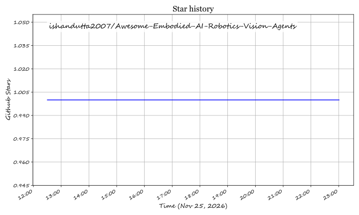

# Awesome-Embodied-AI-Robotics-Vision-Agents

  

  
  
  
  
  

# 👁️ Top Embodied AI & Robotics Vision Agents 🤖

> **A curated directory of commercial Physical AI SaaS platforms and premier open-source repositories powering Vision-Language-Action (VLA) foundation models, 6-DoF robotic manipulation, zero-shot visual grasping, spatial reasoning, and humanoid vision agents.**

---

### 🔍 Quick Navigation & SEO Highlights
- **Keywords**: *Embodied AI, Robotics Vision Agents, Vision-Language-Action (VLA), OpenVLA, LeRobot, Physical AI, Humanoid Robotics, 6D Pose Estimation, Zero-Shot Grasping, FoundationPose, Robot Learning, Sim-to-Real, ROS 2 Vision.*
- **Target Audience**: Robotics Software Engineers, Computer Vision Researchers, Autonomous Systems Architects, Physical AI Founders.

---

## 📑 Table of Contents
- [📊 Sector Overview & Market Dynamics](#-sector-overview--market-dynamics)
- [☁️ SaaS & Commercial Physical AI Platforms](#️-saas--commercial-physical-ai-platforms)
- [💻 Open-Source GitHub Repositories](#-open-source-github-repositories)
- [📈 Star History](#-star-history)
- [🛠️ How to Contribute](#️-how-to-contribute)
- [💖 Support & Sponsorship](#-support--sponsorship)
- [⚠️ Disclaimer](#️-disclaimer)

---

## 📊 Sector Overview & Market Dynamics

The global Embodied AI & Robotics Vision Agent market is estimated at **$18.4 billion in 2026** and is projected to surpass **$74 billion by 2032**, expanding at a rapid compound annual growth rate (**CAGR of ~26.5%**). Market dynamics exhibit a **moderately-to-highly concentrated foundation layer**—where massive venture capital rounds and hyperscaler acquisitions center around flagship generalist VLA developers (Figure AI, Skild AI, Physical Intelligence, Amazon/Covariant)—alongside a **vibrantly fragmented edge/application layer** encompassing hundreds of specialized industrial vision integrators, multi-modal sensor startups, and open-source collaborative ecosystems.

---

## ☁️ SaaS & Commercial Physical AI Platforms

*Commercial platforms, Robot-as-a-Service (RaaS) providers, and enterprise foundation model engines. Sorted descending by company valuation / annual revenue scale.*

| Platform | Company Scale (Valuation / Revenue) | Description | Pricing (Starting Paid Tier) | Free Tier / Trial Limit |
| :--- | :--- | :--- | :--- | :--- |
| **[Figure AI (Helix Platform)](https://figure.ai)** | **~$39.5B Valuation** (Series C mega-round; enterprise automotive fleet contracts) | End-to-end commercial humanoid robotics and Helix Vision-Language-Action (VLA) neural network platform delivering sub-second upper-body manipulation, visual scene reasoning, and autonomous multi-step physical workflows. | **$5,000 / month** per humanoid unit (Robot-as-a-Service starter deployment contract with 12-month commitment) | **30-day Enterprise Pilot Program** (Guided on-site technical validation and digital twin simulation review; no perpetual free tier) |
| **[Skild AI](https://skild.ai)** | **~$14.0B Valuation** (Backed by SoftBank, NVIDIA, Amazon, Lightspeed) | General-purpose omni-bodied physical AI foundation model ("Skild Brain") providing shared vision-locomotion-manipulation intelligences across heterogeneous mobile robots, quadrupeds, and bimanual systems. | **$3,500 / month** per active robot instance (Enterprise base model runtime API & fine-tuning license) | **14-day Simulation Sandbox Preview** (Cloud simulation environment access for accredited commercial partners; no public perpetual free tier) |
| **[Physical Intelligence ($\pi_0$ / Pi)](https://physicalintelligence.company)** | **~$5.6B Valuation** ($400M+ funding from Thrive, Lux, OpenAI, Bezos Expeditions) | Generalist physical foundation models utilizing flow-matching Vision-Language-Action architectures ($\pi_0$ and $\pi_{0.5}$) for dexterous multi-task folding, assembling, and sorting. | **$2,500 / month** per robot cell license (Commercial fine-tuned enterprise inference stack) | **Free Forever Base Model Weights** (`openpi` Apache-2.0 base weights free on Hugging Face; commercial cloud APIs offer 30-day sandbox tokens) |
| **[Dexterity AI](https://dexterity.ai)** | **~$1.65B Valuation** ($200M+ venture funding; scaled logistics deployments) | Force-guided autonomous manipulation platform powering bimanual truck loading, mixed-SKU depalletizing, and high-speed parcel induction in global distribution centers. | **$4,000 / month** per robotic workcell (Software subscription under multi-year RaaS agreement) | **60-day Logistics Facility Assessment** (Full warehouse throughput modeling and synthetic twin validation; no public free tier) |
| **[Boston Dynamics Orbit (Hyundai)](https://bostondynamics.com)** | **~$1.10B Valuation** (80% controlling acquisition by Hyundai Motor Group) | Centralized fleet operations, AI-based thermography, thermal/acoustic acoustic inspection, and automated mission dispatch platform for Spot, Stretch, and Atlas. | **$15,000 / year** per site license (Orbit Enterprise fleet software tier; hardware priced separately) | **30-day Orbit Cloud Trial** (Includes 5 virtual simulated Spot robots and full dashboard features during hardware evaluation) |
| **[Covariant (Amazon / RFM-1)](https://covariant.ai)** | **~$625M Valuation** (Key tech & team acqui-hired/licensed by Amazon in $400M+ transaction) | Robotic Foundation Model (RFM-1) platform enabling universal multi-modal understanding, physical object grasp synthesis, and zero-shot item handling. | **$2,000 / month** per picking station (Enterprise warehouse AI vision runtime) | **30-day On-Premise Evaluation** (Managed proof-of-concept run with up to 1,000 test picks; no perpetual free tier) |
| **[Berkshire Grey (SoftBank)](https://berkshiregrey.com)** | **~$375M Valuation** (Acquired by SoftBank Group; ~$70M+ annual revenue) | Intelligent enterprise robotic picking, automated induction, and dynamic mobile sortation systems tailored for retail, e-commerce, and parcel operations. | **$3,000 / month** per deployed module (Bundled enterprise automation subscription & software maintenance) | **45-day ROI Simulation Pilot** (Detailed warehouse digital twin simulation with historical SKU profile matching; no perpetual free tier) |
| **[Sanctuary AI (Carbon AI)](https://sanctuary.ai)** | **~$350M Valuation** ($140M+ VC & Canadian Innovation funding) | Carbon cognitive architecture combining vision-language spatial perception and high-rate haptic-teleoperation loops for Phoenix general-purpose humanoids. | **$4,500 / month** per Phoenix unit (Industrial pilot deployment contract) | **30-day Managed Facility Sandbox** (Includes teleoperation control evaluation and workspace reachability scans; no perpetual free tier) |
| **[Vicarious (Intrinsic / Alphabet)](https://intrinsic.ai)** | **~$300M Valuation** (Acquired into Alphabet Intrinsic robotics division) | Probabilistic visual cortex reasoning and automated robotic toolpath synthesis integrated directly into Alphabet's Intrinsic Flowstate development suite. | **$200 / month** per developer seat (Intrinsic Flowstate Studio Pro starting tier) | **Free Forever Community Tier** (Up to 2 active projects, 5 hours of cloud simulation compute per month, and public community forum support) |

---

## 💻 Open-Source GitHub Repositories

*Leading open-source codebases, neural vision foundation models, simulation suites, and robot learning frameworks. Sorted descending by GitHub Stars_Count.*

| Repository | GitHub_Stars | Category / Tech Stack | License | Description |
| :--- | :---: | :--- | :--- | :--- |
| **[ultralytics/ultralytics](https://github.com/ultralytics/ultralytics)** |  | Computer Vision / Real-Time Perception | AGPL-3.0 | Real-time object detection, instance segmentation, oriented bounding box (OBB) tracking, and pose estimation standard for robotic vision. |
| **[huggingface/lerobot](https://github.com/huggingface/lerobot)** |  | Robot Learning / End-to-End Policies | Apache-2.0 | Hugging Face's open platform for end-to-end robot learning with pretrained vision policies (ACT, Diffusion Policy) and low-cost hardware support. |
| **[google-deepmind/mujoco](https://github.com/google-deepmind/mujoco)** |  | Physics Simulation / Contact Dynamics | Apache-2.0 | Multi-Joint dynamics with Contact engine by Google DeepMind; the global reference simulator for embodied AI, reinforcement learning, and visual control. |
| **[IDEA-Research/Grounded-Segment-Anything](https://github.com/IDEA-Research/Grounded-Segment-Anything)** |  | Open-Vocabulary Zero-Shot Vision | Apache-2.0 | Combines Grounding DINO with Segment Anything (SAM / SAM-2) to detect, segment, and label any physical object with text prompt grounding. |
| **[Physical-Intelligence/openpi](https://github.com/Physical-Intelligence/openpi)** |  | Generalist VLA Foundation Models | Apache-2.0 | Official open-source release of Physical Intelligence's $\pi_0$ and $\pi_0$-FAST flow-matching Vision-Language-Action generalist robot policies. |
| **[DepthAnything/Depth-Anything-V2](https://github.com/DepthAnything/Depth-Anything-V2)** |  | Monocular Depth Estimation | Apache-2.0 | Highly capable foundation model for metric monocular depth estimation, essential for 3D spatial grounding and obstacle avoidance from RGB cameras. |
| **[openvla/openvla](https://github.com/openvla/openvla)** |  | 7B Open Vision-Language-Action Model | MIT | 7-billion parameter open-source VLA model trained on Open X-Embodiment datasets, supporting fine-tuning on consumer GPUs with LoRA/QLoRA. |
| **[kuafuai/andee](https://github.com/kuafuai/andee)** |  | Autonomous Vision-Action Agent | MIT | Multimodal vision-agent framework running on edge/desktop devices that perceives user interfaces, interprets visual context, and executes complex sequential tasks. |
| **[NVlabs/FoundationPose](https://github.com/NVlabs/FoundationPose)** |  | 6D Object Pose Estimation & Tracking | CC-BY-NC-SA-4.0 | NVIDIA unified foundation model for 6D object pose estimation and novel-view tracking from RGB-D inputs without requiring CAD model retraining. |
| **[mani-skill/ManiSkill](https://github.com/mani-skill/ManiSkill)** |  | GPU-Accelerated Robot Simulation | Apache-2.0 | High-performance GPU-parallelized manipulation benchmark powered by SAPIEN, rendering photorealistic RGB-D point clouds at tens of thousands of FPS. |
| **[facebookresearch/habitat-lab](https://github.com/facebookresearch/habitat-lab)** |  | Embodied AI Navigation & Manipulation | MIT | Modular high-level library by Meta AI to train embodied agents across high-fidelity 3D indoor scenes with photo-realistic sensor observations. |
| **[Farama-Foundation/Gymnasium-Robotics](https://github.com/Farama-Foundation/Gymnasium-Robotics)** |  | Standard RL Robotics Environments | MIT | Farama Foundation's standardized reinforcement learning environments for bimanual manipulation, robotic arms, and dexterous hands with visual observation spaces. |
| **[octo-models/octo](https://github.com/octo-models/octo)** |  | Generalist Robot Policy Transformer | MIT | Transformer-based robot policy trained on 800k real-world robot demonstrations across distinct camera viewpoints and action embodiments. |
| **[ARISE-Initiative/robomimic](https://github.com/ARISE-Initiative/robomimic)** |  | Imitation & Offline Reinforcement Learning | MIT | Standardized modular framework for robot learning from demonstration with visual encoders, teleoperation collection, and reproducible benchmarks. |

---

## 📈 Star History

---

## 🛠️ How to Contribute 🤝

Contributions are wholeheartedly welcome! To add or update an Embodied AI SaaS platform or open-source repository:

1. **Fork the repository** to your GitHub profile.
2. **Create a descriptive feature branch**: `git checkout -b feature/add-new-robot-agent`.
3. **Verify criteria**:
   - For **SaaS / Commercial entries**: Ensure specific starting tier pricing and explicit trial or free tier parameters are documented.
   - For **Open-Source entries**: Include active repository links, licensing, and correct badge tags linking directly to the repo's `/stargazers` URL.
4. **Submit a pull request** with an explanation of why the addition is relevant for the physical AI community.

---

## 💖 Support & Sponsorship ☕

If this curated collection assists your research, robotics prototyping, or engineering workflows, consider supporting its continuous maintenance:

- ⭐ **Star the Repository**: Show appreciation by starring this repo on [GitHub](https://github.com/ishandutta2007/Awesome-Embodied-AI-Robotics-Vision-Agents).
- 🍴 **Fork & Share**: Share it with fellow roboticists, AI researchers, and builders on Discord, Twitter/X, and LinkedIn.
- ☕ **Sponsor & Buy a Coffee**: Support ongoing open-source curation via the [GitHub Sponsors Dashboard](https://github.com/sponsors/ishandutta2007).

---

## ⚠️ Disclaimer

*All trademarks, logos, and brand names are the property of their respective owners. Mention of commercial products, companies, or open-source packages does not constitute an endorsement. Pricing tiers, valuations, and trial policies reflect public 2026 data and may change at the discretion of individual vendors.*

## ⭐ Star History

<a href="https://star-history.com/#ishandutta2007/Awesome-Embodied-AI-Robotics-Vision-Agents&Timeline" align="center">
  <picture>
    <source media="(prefers-color-scheme: dark)" srcset="assets/ishandutta2007_Awesome-Embodied-AI-Robotics-Vision-Agents_growth.svg">
    
  </picture>
</a>
